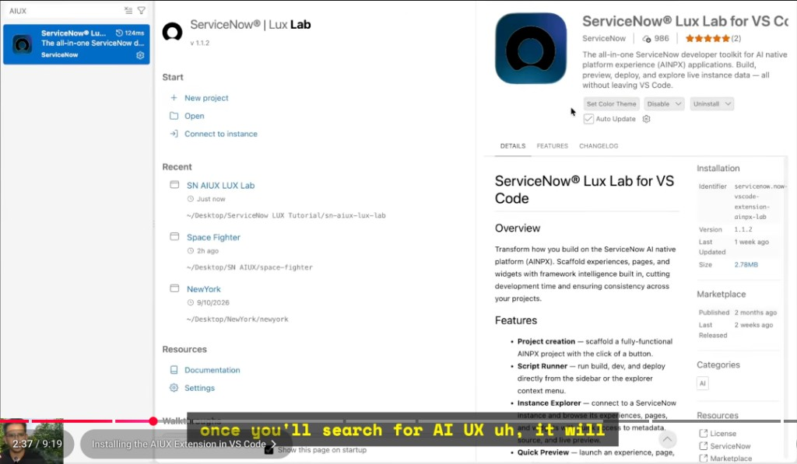
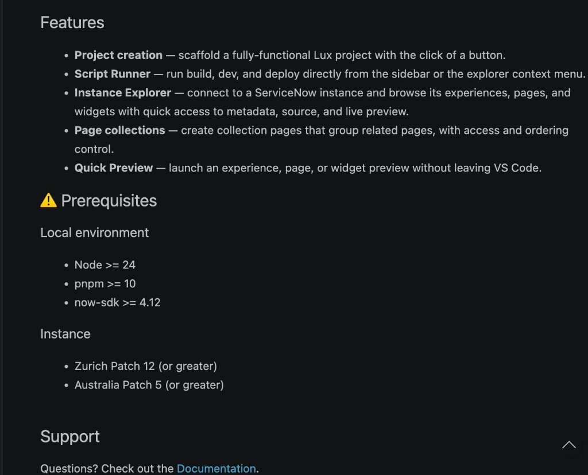
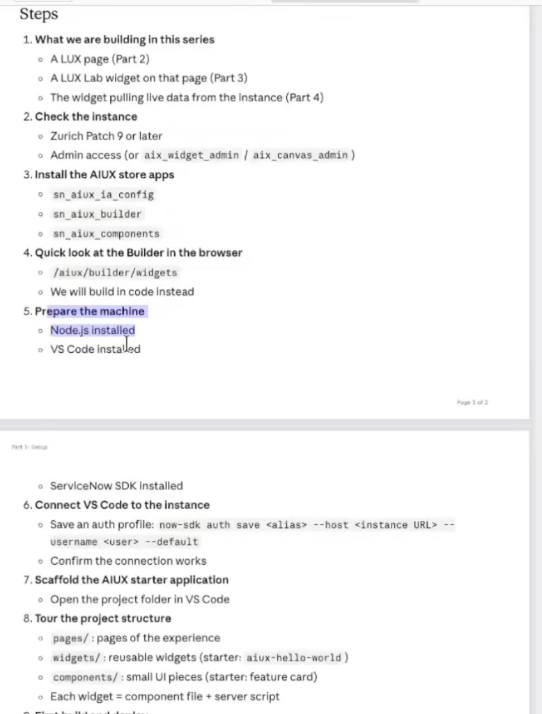
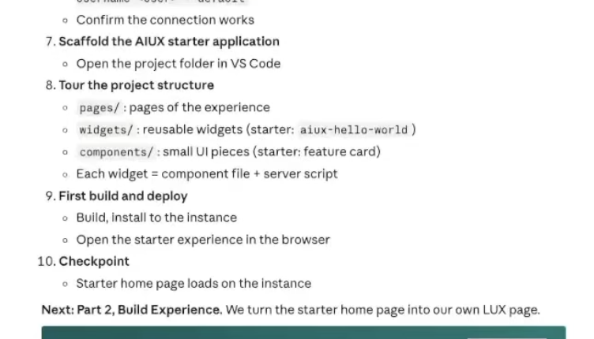

# ServiceNow AIUX (Lux Lab) – Setup Notes

Step-by-step notes for setting up the **AIUX / Lux Lab** development environment in VS Code and building the first app on a ServiceNow instance.

**Sources**
- Video 1: *Installing the AIUX Extension in VS Code* (from the series: https://www.youtube.com/watch?v=2ZlCQjZm24g&list=PLdYapAc7PyN8&index=1)
- Screenshots in [`images/`](images/) (extension page, prerequisites, and the written step list)
- Your local project: `my-lux-app/` (in the parent workspace folder)

---

## Quick Reference

| Item | Value |
|---|---|
| VS Code extension | **ServiceNow® Lux Lab for VS Code** |
| Extension identifier | `servicenow.now-vscode-extension-ainpx-lab` |
| Extension version (from screenshot) | 1.1.2 |
| Node.js | **>= 24** (project `.nvmrc` = `24.14.1`) |
| pnpm | **>= 10** |
| ServiceNow SDK (`now-sdk`) | **>= 4.12** (project uses `4.14.0`) |
| Instance (extension page) | **Zurich Patch 12+** or **Australia Patch 5+** |
| Instance (written steps) | Zurich Patch 9+ (see the note in Step 2) |
| Your project | `my-lux-app` |
| Project scope | `x_2212578_my_lux_a` (from `now.config.json`) |
| Landing page | `/home` (from `aiux.json`) |

---

## Overview: What We Are Building

From the written steps (screenshot 3):

1. **Part 2** – A Lux page
2. **Part 3** – A Lux Lab widget on that page
3. **Part 4** – The widget pulling live data from the instance

**Part 1 (this document): Setup.** The goal is to get a starter app built, deployed, and loading on the instance.

---

## Step 1 – Install VS Code

1. Download VS Code from the official site (https://code.visualstudio.com).
2. Install it and open it once.

---

## Step 2 – Check the Prerequisites

From screenshot 2, the extension requires:

**Local machine**
- Node.js **>= 24**
- pnpm **>= 10**
- now-sdk **>= 4.12**

**Instance**
- Zurich **Patch 12** or greater, **or**
- Australia **Patch 5** or greater

> **Note:** The written steps (screenshot 3) say *Zurich Patch 9 or later*, but the extension page says *Patch 12 or greater*. Use **Patch 12+** to be safe, because the extension's requirement is the stricter one.

**Instance access needed**
- Admin access, **or** the roles `aix_widget_admin` / `aix_canvas_admin`

---

## Step 3 – Install Node.js, Then Verify

If Node.js is not installed yet, install **Node 24 or newer** from https://nodejs.org.

Check the versions in a terminal:

```bash
node -v      # should be v24.x or higher
npm -v
```

---

## Step 4 – Install the Required Global Tools

Run these in a terminal, in order:

```bash
npm install -g @servicenow/sdk
npm install -g npm@12.2.2
npm install -g pnpm@10
```

Verify that each tool installed:

```bash
now-sdk --version     # should be 4.12 or higher
npm -v                # 12.2.2 expected
pnpm -v               # 10.x expected
```

> Tip: If `now-sdk` is "command not found", close and reopen the terminal (or VS Code) so the new PATH is loaded.

---

## Step 5 – Install the VS Code Extension

1. Open VS Code.
2. Click the **Extensions** icon in the left sidebar (or press `Cmd+Shift+X` on Mac).
3. Search for **AIUX** (for example, "AIUX" or "Lux Lab").
4. Choose **ServiceNow® Lux Lab for VS Code** (publisher: **ServiceNow**).
5. Click **Install**.

Confirm the details match screenshot 1:
- Identifier: `servicenow.now-vscode-extension-ainpx-lab`
- Version: `1.1.2`

**Features you will see after installing** (screenshot 2):
- **Project creation** – scaffold a full Lux project with a click
- **Script Runner** – run build, dev, and deploy from the sidebar or the Explorer right-click menu
- **Instance Explorer** – connect to an instance and browse its experiences, pages, and widgets
- **Page collections** – group related pages, with access and ordering control
- **Quick Preview** – open an experience, page, or widget preview without leaving VS Code

Where to find them: the **left sidebar** of VS Code shows the **AIUX / ServiceNow Lux Lab** icon. Open it to see **Instance Explorer**, **Script Runner**, and **Quick Preview**.

---

## Step 6 – Connect VS Code to the Instance

You need your instance URL, your username, and access through OAuth (as shown in the video).

**Option A – From VS Code (Instance Explorer)**
1. Open the **Instance Explorer** in the sidebar.
2. Add a connection with:
   - **Instance name** (your instance URL, for example `https://yourinstance.service-now.com`)
   - **OAuth** sign-in (follow the browser prompt and allow access)
3. Confirm the instance appears and you can browse its contents.

**Option B – From the terminal (SDK auth profile)**

From the written steps:

```bash
now-sdk auth save <alias> --host <instance URL> --username <user> --default
```

Example:

```bash
now-sdk auth save mydev --host https://yourinstance.service-now.com --username your.user --default
```

Then confirm the connection works. The `--default` flag makes this the profile that the commands use.

---

## Step 7 – Install the AIUX Store Apps on the Instance

On the instance, install these three apps from the ServiceNow Store (or App Manager):

- `sn_aiux_ia_config`
- `sn_aiux_builder`
- `sn_aiux_components`

Then open the Builder in the browser to take a quick look (we will build in code, not in the Builder):

```
https://<your-instance>/aiux/builder/widgets
```

---

## Step 8 – Create a New Project in VS Code

Using the extension's **Project creation** feature:

1. Click **New Project** (in the AIUX sidebar, or under **Start**).
2. **Create a folder** for the project and **give VS Code access** to it when asked.
3. Enter the **project name** (in our case: `My Lux App`).
4. Choose the project type: **Standalone App**.
5. Enter the **scope prefix**. The scope in our project is `x_2212578_my_lux_a` (from `now.config.json`). Use the scope you were given for your own instance, and keep the value consistent across the project.

Open the project folder in VS Code when it finishes.

---

## Step 9 – Know the Project Structure

Typical layout (from the written steps and `my-lux-app`):

| Folder / file | What it is |
|---|---|
| `pages/` | Pages of the experience (for example `pages/home/page.js`) |
| `widgets/` | Reusable widgets (starter: `widgets/aiux-hello-world/`) |
| `components/` | Small UI pieces (starter: feature card, `pages/home/components/aiux-feature-card.js`) |
| `widgets/<name>/index.js` | Widget **component** file (UI) |
| `widgets/<name>/server-script.js` | Widget **server script** (data from the instance) |
| `aiux.json` | App name, `basename`, landing page (`/home`) |
| `now.config.json` | Scope, scope ID, metadata output folders |
| `package.json` | The `build`, `dev`, and `deploy` scripts |
| `.env` | Local secrets. **Never commit this file.** |

**Rule of thumb:** each widget = one component file + one server script.

---

## Step 10 – First Build and Deploy

Use the **Script Runner** in the sidebar (or right-click in the Explorer):

1. **Build** → runs `pnpm run build` (`now-sdk build`)
2. **Run Dev** → runs `pnpm run dev` (`now-sdk run dev`)

Or run them directly in the VS Code terminal from the project folder:

```bash
pnpm install
pnpm run build
pnpm run dev
```

To install (deploy) the build to the instance, the project script is:

```bash
pnpm run deploy        # runs: now-sdk install
```

> `pnpm run deploy` is from the project's `package.json`. It was not shown in the screenshots, so check the Script Runner for the exact deploy option in your version of the extension.

Then open the starter experience in the browser:

```
https://<your-instance>/<basename>/home
```

For this project, `basename` is `my-lux-app` (from `aiux.json`), so the URL is:

```
https://<your-instance>/my-lux-app/home
```

Note: the landing page is `/home` and the basename is `my-lux-app`. The exact URL path can vary by setup, so confirm it in the Instance Explorer or in the Quick Preview if it does not load.

---

## Step 11 – Checkpoint

You are done with Part 1 when:

- [ ] VS Code is installed
- [ ] The **ServiceNow® Lux Lab for VS Code** extension is installed (v1.1.2)
- [ ] `node -v` is 24 or higher, `now-sdk` is 4.12+, and `pnpm -v` is 10+
- [ ] VS Code is connected to the instance (Instance Explorer or `now-sdk auth save`)
- [ ] The three AIUX store apps are installed on the instance
- [ ] The project is created (Standalone App, with a scope prefix)
- [ ] `Build` and `Run Dev` work from Script Runner
- [ ] The **starter home page loads** on the instance

**Next: Part 2 – Build Experience.** We turn the starter home page into our own Lux page.

---

## Troubleshooting

| Problem | What to check |
|---|---|
| `now-sdk` not found | Reopen the terminal or VS Code. Re-run `npm install -g @servicenow/sdk`. |
| Wrong Node version | Run `node -v`. Install Node 24+ and restart VS Code. |
| Extension can't see the instance | Check the instance is Zurich Patch 12+ (or Australia Patch 5+). Check your OAuth sign-in. |
| Build fails | Read the terminal output from Script Runner. Run `pnpm install` first. |
| Home page doesn't load | Confirm the store apps are installed, you have the right roles, and the deploy finished. |
| Lost connection to instance | Re-run `now-sdk auth save ...` with `--default`, or sign in again from the Instance Explorer. |

---

## Security Notes

- The `.env` file in the project holds credentials. It is in `.gitignore` in `my-lux-app`. Keep it out of any repo and out of screenshots.
- Do not paste OAuth tokens or passwords into notes or chats.
- The `.gitignore` in this notes repo also excludes `.env`.

---

## Repo Layout

```
AIUX-Lux-Lab-Notes/
├── README.md        <- these notes
├── .gitignore
└── images/          <- screenshots referenced above
    ├── 01-extension-page-and-video.png
    ├── 02-features-and-prerequisites.png
    ├── 03-steps-part1-setup.png
    └── 04-steps-continued.png
```

---

## Screenshots

**1. Extension page and video (Installing the AIUX Extension in VS Code)**



**2. Features and prerequisites**



**3. Written steps (part 1)**



**4. Written steps (continued)**


