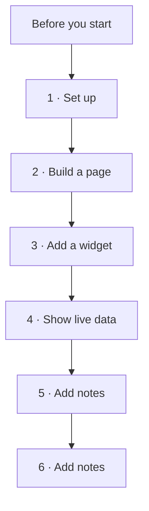

# AIUX notes

Lux and AIUX are the same thing.

This page is only the path. Open one step at a time.
Long notes and commands live in the other folders.

Playlist: https://www.youtube.com/watch?v=2ZlCQjZm24g&list=PLdYapAc7PyN8&index=1

The first video says the course is 4 lessons. This playlist has 6 videos, so steps 5 and 6 are ready for notes when you watch them.

## Before you start

Check this list once. Then start at step 1.

**On your Mac**

- VS Code
- Node.js 24 or newer
- pnpm 10 or newer
- ServiceNow SDK (`now-sdk`) 4.12 or newer

**On your instance**

- Zurich Patch 12 or newer, or Australia Patch 5 or newer
- An admin login, or the role `aix_widget_admin` / `aix_canvas_admin`
- Store apps: `sn_aiux_ia_config`, `sn_aiux_builder`, `sn_aiux_components`

## Path

**1. Set up** — Install the tools, connect VS Code, create the app, and open the preview.
Notes are ready.
[Open notes](notes/01-setup.md) · [Commands](scripts/commands.md)

**2. Build a page** — Turn the starter home page into your own page.
[Open notes](notes/02-build-page.md)

**3. Add a widget** — Make a widget and put it on the page.
[Open notes](notes/03-add-widget.md)

**4. Show live data** — The widget reads data from your instance and shows it on the page.
[Open notes](notes/04-live-data.md)

**5. Video 5** — Notes not added yet.
[Open notes](notes/05-video.md)

**6. Video 6** — Notes not added yet.
[Open notes](notes/06-video.md)

## Folders

| Folder | What is inside |
| --- | --- |
| `notes/` | One file for each video |
| `scripts/` | Commands to copy and run |
| `images/` | Pictures from the lessons |
